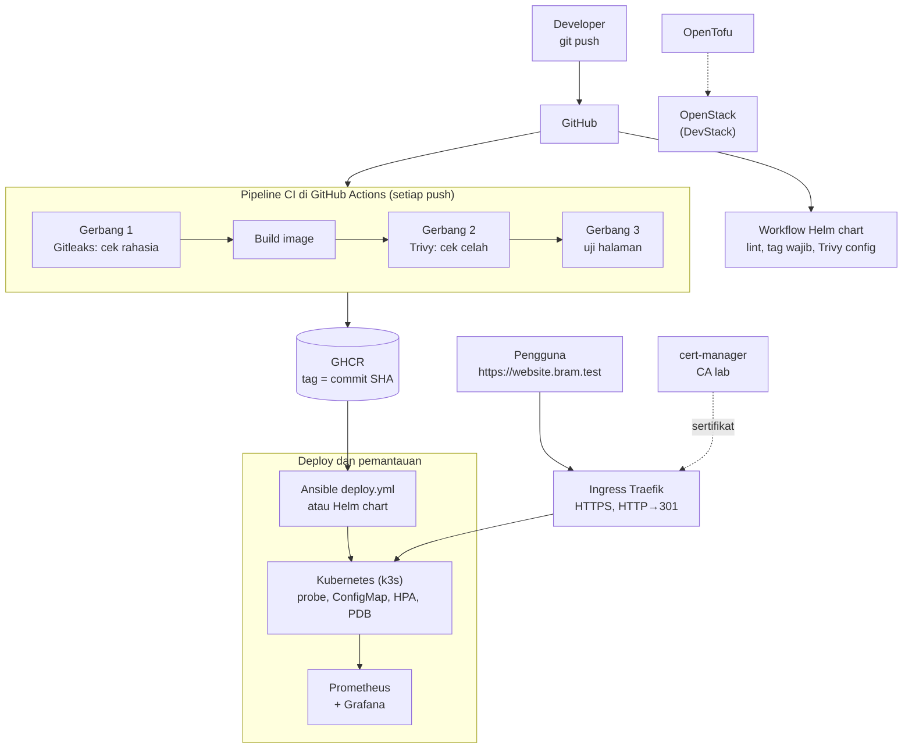

# DevOps Website Bram


Proyek DevOps end-to-end: sebuah website sederhana yang dibangun, diperiksa keamanannya, disimpan di registry, lalu di-deploy ke Kubernetes secara otomatis dan bisa di-rollback dengan satu perintah. Website dibuka lewat HTTPS di Ingress (Traefik) dengan sertifikat yang diterbitkan dan diperpanjang otomatis oleh cert-manager (akses HTTP dialihkan ke HTTPS), dijaga readiness dan liveness probe, jumlah pod menyesuaikan beban dengan HPA, tetap tersedia saat perawatan node berkat PodDisruptionBudget, isi konfigurasinya diambil dari ConfigMap, dan seluruh manifest juga tersedia sebagai Helm chart yang diperiksa di CI dan bisa di-deploy secara GitOps oleh Argo CD. Kondisi server dipantau dengan Prometheus dan Grafana, dan contoh infrastruktur private cloud ditulis dengan OpenTofu.

> **English summary:** End-to-end DevOps project. Every `git push` runs a GitHub Actions pipeline with three gates (Gitleaks secret scan, Trivy vulnerability scan, page test) before the image is pushed to GitHub Container Registry, tagged with the commit SHA. Ansible deploys a specific version to a hardened Kubernetes (k3s) deployment with rolling updates and one-command rollback, readiness/liveness probes, a ConfigMap, and a Traefik Ingress served over HTTPS with certificates issued and renewed automatically by cert-manager (from a name-constrained lab CA, installed by a separate idempotent platform playbook); plain HTTP is redirected with a 301. A HorizontalPodAutoscaler scales the website from 2 to 5 pods on CPU (verified with a load test), and a PodDisruptionBudget keeps at least one pod serving during voluntary disruptions (verified through the Eviction API). The same manifests are packaged as a Helm chart, validated in a separate CI workflow (helm lint, a regression test that the chart refuses to render without an image tag, and a Trivy config scan), and is also deployed GitOps-style by Argo CD using an app-of-apps pattern. Monitoring (Prometheus, node-exporter, Grafana) and its dashboards are provisioned as code. An OpenTofu example provisions an instance on a private OpenStack (DevStack) cloud.

**Penyusun:** Bram Naibaho, D3 Teknologi Komputer, Institut Teknologi Del

---

## Arsitektur



| Tahap | Alat | Fungsi |
| --- | --- | --- |
| Kode | Git, GitHub | Semua kode, konfigurasi, dan dashboard disimpan di repository ini |
| CI | GitHub Actions | Build dan uji otomatis setiap `git push` |
| Keamanan | Gitleaks, Trivy | Pipeline gagal kalau ada rahasia bocor atau celah HIGH/CRITICAL yang bisa diperbaiki |
| Container | Docker, nginx-unprivileged | Website berjalan tanpa root, di port 8080, dengan HEALTHCHECK |
| Registry | GitHub Container Registry | Image disimpan dengan tag `latest` dan tag commit SHA |
| Deploy | Ansible, Kubernetes (k3s) | Deploy versi tertentu, rolling update, rollback satu perintah |
| Ketahanan | Readiness dan liveness probe | Versi yang rusak tertahan saat rolling update, container macet di-restart otomatis |
| Konfigurasi | ConfigMap | Isi halaman `/info/` berubah tanpa build image dan tanpa restart pod |
| Akses | Ingress (Traefik) | Website dibuka lewat nama alamat, tanpa `port-forward` |
| HTTPS | cert-manager, CA lab, Middleware Traefik | Sertifikat diterbitkan otomatis dari anotasi Ingress, berlaku 90 hari, diperpanjang otomatis; HTTP dialihkan ke HTTPS (301) |
| Skala | HorizontalPodAutoscaler | 2 sampai 5 pod mengikuti beban CPU (target 50% dari requests) |
| Ketersediaan | PodDisruptionBudget | Minimal 1 pod tetap melayani saat drain atau upgrade node |
| Paket | Helm, Argo CD | Chart dengan `values.yaml`, riwayat revisi, dan rollback; diperiksa di CI; bisa di-deploy GitOps oleh Argo CD |
| Monitoring | Prometheus, node-exporter, Grafana | Data source dan dashboard dipasang otomatis dari file |
| Infrastruktur | OpenTofu, OpenStack | Contoh membuat instance di private cloud dari kode |

---

## Hasil keamanan

| Pemeriksaan | Sebelum | Sesudah | Cara |
| --- | --- | --- | --- |
| Rahasia di riwayat Git (Gitleaks) | - | 0 kebocoran | `.gitignore`, password di `.env` dan `clouds.yaml` di luar repository |
| Celah HIGH/CRITICAL image (Trivy) | 66 | 0 | Base image Debian diganti Alpine |
| Celah yang ditangkap gerbang CI | 6 (1 CRITICAL) | 0 | `apk upgrade` saat build |
| Temuan konfigurasi Dockerfile | 2 | 0 | `USER` non-root dan `HEALTHCHECK` |
| Temuan konfigurasi Kubernetes | 19 | 1 | securityContext, batas CPU/RAM, namespace sendiri |
| Temuan HIGH/CRITICAL di Helm chart | - | 0 | Diperiksa Trivy di workflow Helm chart setiap ada perubahan chart |

Sisa satu temuan (KSV-0125, registry publik) diterima secara sadar untuk lingkungan lab. Di lingkungan perusahaan, image disimpan di registry privat yang diizinkan.

---

## Struktur repository

```
.
├── .github/workflows/
│   ├── ci.yml                      # Pipeline CI: Gitleaks, build, Trivy, uji, push ke GHCR
│   └── helm.yml                    # Gerbang chart: helm lint, tag wajib, Trivy config
├── app/
│   ├── Dockerfile                  # nginx tanpa root, port 8080, HEALTHCHECK
│   └── index.html
├── k8s/
│   ├── website.yaml.j2             # Deployment, Service, ConfigMap, Middleware, Ingress + TLS, HPA, PDB; versi image diisi Ansible
│   └── cluster-issuer.yaml         # ClusterIssuer cert-manager (CA lab)
├── helm/website/                   # Helm chart: Chart.yaml, values.yaml, templates/
├── ansible/
│   ├── inventory.ini
│   ├── platform.yml                # Lapisan platform: cert-manager, CA lab, ClusterIssuer
│   └── deploy.yml                  # Lapisan aplikasi: nyalakan k3s, isi template, apply, tunggu rollout
├── monitoring/
│   ├── compose.yaml                # node-exporter, Prometheus, Grafana
│   ├── prometheus.yml
│   └── grafana/                    # Data source dan dashboard sebagai kode
└── infra/opentofu-openstack/       # Contoh instance OpenStack dengan OpenTofu
```

---

## Cara menjalankan

### Prasyarat

- Linux (diuji di Ubuntu 24.04 di WSL2) dengan Docker, Ansible, dan k3s
- `kubectl` dapat mengakses cluster melalui `~/.kube/config`

### 1. Uji aplikasi secara lokal

```bash
docker build -t devops-website-bram:local ./app
docker run -d --name uji -p 8080:8080 devops-website-bram:local
curl -s http://localhost:8080 | grep "<title>"
docker rm -f uji
```

### 2. Platform: HTTPS dengan cert-manager

Buat CA lab sekali saja, di luar repository. CA ini dibatasi (*name constraints*) hanya untuk `bram.test`, sehingga tidak bisa dipakai memalsukan situs lain:

```bash
mkdir -p ~/lab-ca && chmod 700 ~/lab-ca && cd ~/lab-ca
openssl req -x509 -newkey rsa:2048 -nodes -keyout ca.key -out ca.crt -days 365 \
  -subj "/CN=Bram Lab CA" \
  -addext "basicConstraints=critical,CA:TRUE" \
  -addext "keyUsage=critical,keyCertSign,cRLSign" \
  -addext "nameConstraints=critical,permitted;DNS:bram.test"
chmod 600 ca.key
```

Pasang cert-manager, Secret CA, dan ClusterIssuer (idempoten):

```bash
cd ansible
ansible-playbook -i inventory.ini platform.yml
```

Agar browser Windows percaya, impor `ca.crt` (bukan `ca.key`) ke daftar CA akun Windows, dan cocokkan thumbprint dengan `openssl x509 -in ~/lab-ca/ca.crt -noout -fingerprint -sha1` sebelum menyetujui:

```bash
cp ~/lab-ca/ca.crt /mnt/c/Users/<user>/Downloads/bram-lab-ca.crt
powershell.exe -NoProfile -Command 'Import-Certificate -FilePath "$env:USERPROFILE\Downloads\bram-lab-ca.crt" -CertStoreLocation Cert:\CurrentUser\Root'
```

Setelah selesai berlatih, hapus lagi CA ini dari Windows:

```bash
powershell.exe -NoProfile -Command 'Get-ChildItem Cert:\CurrentUser\Root | Where-Object Subject -eq "CN=Bram Lab CA" | Remove-Item'
```

### 3. Deploy ke Kubernetes (versi tertentu)

Setiap image di GHCR diberi tag commit SHA. Deploy versi commit terakhir:

```bash
cd ansible
ansible-playbook -i inventory.ini deploy.yml -K -e image_tag=$(git rev-parse HEAD)
curl -s http://website.localhost/ | grep "<title>"
curl -s http://website.localhost/info/
curl -sI http://website.bram.test/ | head -3      # 301, Location: https://website.bram.test/
```

Website dilayani Ingress Traefik bawaan k3s; `https://website.bram.test` memakai sertifikat dari cert-manager. Untuk membukanya dari browser Windows (WSL2), arahkan `website.bram.test` ke IP WSL di file hosts Windows. IP-nya terlihat di kolom EXTERNAL-IP:

```bash
kubectl get svc -n kube-system traefik
```

```
# C:\Windows\System32\drivers\etc\hosts (dibuka sebagai Administrator)
<EXTERNAL-IP>    website.bram.test
```

### 3b. Uji autoscaling (HPA) dan PodDisruptionBudget

Jumlah pod dipegang HPA (2 sampai 5, target CPU 50%), jadi Deployment tidak menulis `replicas`. Beri beban lalu amati:

```bash
kubectl run beban -n website --image=busybox:1.36 --restart=Never -- /bin/sh -c \
  'for i in 1 2 3 4 5 6; do (while true; do wget -q -O /dev/null http://website; done) & done; wait'
kubectl get hpa -n website -w            # CPU naik, pod 2 → 5 dalam sekitar 30 detik
kubectl delete pod beban -n website      # pod kembali ke 2 setelah stabilization window (sekitar 5 menit)
```

PodDisruptionBudget (`minAvailable: 1`) diuji lewat Eviction API, jalur yang sama dengan `kubectl drain`:

```bash
usir() { printf '{"apiVersion":"policy/v1","kind":"Eviction","metadata":{"name":"%s","namespace":"website"}}' "$1" \
  | kubectl create --raw "/api/v1/namespaces/website/pods/$1/eviction" -f - ; echo; }
P1=$(kubectl get pods -n website -l app=website -o jsonpath='{.items[0].metadata.name}')
P2=$(kubectl get pods -n website -l app=website -o jsonpath='{.items[1].metadata.name}')
usir "$P1"; usir "$P2"     # pertama 201 Success, kedua 429 TooManyRequests
```

### 4. Rollback

Kembali ke versi sebelumnya cukup dengan mengganti tag:

```bash
ansible-playbook -i inventory.ini deploy.yml -K -e image_tag=$(git rev-parse HEAD~1)
```

Kubernetes mengganti pod secara bertahap (rolling update), jadi website tidak mati selama pergantian. Readiness probe memastikan pod lama baru dimatikan setelah pod baru benar-benar siap.

### 4b. Alternatif: deploy dengan Helm

```bash
helm install website helm/website -n website-helm --create-namespace \
  --set image.tag=$(git rev-parse HEAD) --wait
helm upgrade website helm/website -n website-helm --set image.tag=$(git rev-parse HEAD) --set replicaCount=3 --wait
helm history website -n website-helm
helm rollback website 1 -n website-helm --wait
helm uninstall website -n website-helm
```

Chart menolak dipasang tanpa `image.tag`, supaya tidak ada deploy tanpa versi yang jelas. Untuk cluster tanpa ingress controller, Ingress bisa dimatikan dengan `--set ingress.enabled=false` (chart 0.2.0).

### 4c. Alternatif: GitOps dengan Argo CD

Chart yang sama di-deploy oleh Argo CD dari repository ini, dengan pola *app of apps* (Application `root` dipasang OpenTofu, Application lain cukup berupa file YAML di Git). Contohnya ada di repository [latihan-devops](https://github.com/Bram-02/latihan-devops), folder `week11/`.

### 5. Monitoring

```bash
cd monitoring
read -s -p "Password admin Grafana: " PW; echo "GF_SECURITY_ADMIN_PASSWORD=$PW" > .env; unset PW
chmod 600 .env
docker compose up -d
```

- Grafana: `http://localhost:3000` (user `admin`), dashboard **Node Exporter Full** langsung tersedia
- Prometheus: `http://localhost:9090/targets`

### 6. Infrastruktur OpenStack (opsional)

Membutuhkan OpenStack (misalnya DevStack) dan kredensial di `~/.config/openstack/clouds.yaml`, yang tidak disimpan di repository.

```bash
cd infra/opentofu-openstack
tofu init
tofu plan
tofu apply
```

---

## Keputusan desain

- **Tag image = commit SHA, bukan `latest`.** Tag `latest` tidak memicu update di Kubernetes karena namanya tidak berubah, tidak bisa dilacak, dan tidak bisa di-rollback dengan pasti. Commit SHA unik untuk setiap versi.
- **Gerbang keamanan di CI.** Image yang membawa rahasia atau celah HIGH/CRITICAL yang sudah ada perbaikannya tidak pernah sampai ke registry. Opsi `--ignore-unfixed` dipakai agar rilis tidak terblokir oleh celah yang belum punya perbaikan.
- **Least privilege.** Container berjalan sebagai user biasa, sistem file hanya-baca, semua capability Linux dicabut, dan setiap pod dibatasi CPU dan RAM-nya.
- **Readiness dan liveness probe.** Kubernetes tidak memakai `HEALTHCHECK` dari Dockerfile, jadi kesehatan pod diperiksa dengan probe. Saat diuji dengan probe yang sengaja dirusak, rolling update berhenti dan versi lama tetap melayani (HTTP 200).
- **Konfigurasi terpisah dari image.** ConfigMap dipasang sebagai volume sehingga perubahan isinya sampai ke pod tanpa restart. Secret tidak pernah ditulis di Git, karena isinya hanya di-encode base64, bukan dienkripsi.
- **Versi dikunci.** Runner CI memakai `ubuntu-24.04`, bukan `ubuntu-latest`, dan action memakai versi mayor yang jelas, supaya pipeline tidak berubah tanpa disadari.
- **HTTPS dengan CA lab yang dibatasi.** Domain `.test` tidak bisa memakai Let's Encrypt, jadi dipakai CA sendiri dengan *name constraints* `bram.test`, kunci CA berizin 600 di luar repository, dan dipercaya hanya di akun Windows pengguna. Mekanismenya sama dengan production: cert-manager menerbitkan dan memperpanjang sertifikat dari anotasi Ingress.
- **HTTP dipaksa ke HTTPS, per Ingress.** Middleware Traefik `redirectScheme` berlaku untuk semua host di satu Ingress, jadi Ingress dipisah: `website` (website.bram.test, TLS, redirect) dan `website-local` (website.localhost, HTTP). Nama `website` dipertahankan karena Certificate `website-tls` dimiliki Ingress itu.
- **Satu objek, satu pemilik: replika dipegang HPA.** `replicas` dihapus dari Deployment supaya setiap deploy tidak menimpa keputusan HPA. HPA naik cepat dan turun lambat (stabilization window 5 menit) untuk mencegah flapping.
- **PDB untuk gangguan yang disengaja.** `minAvailable: 1` membuat drain atau upgrade mengusir pod satu per satu dan menunggu pengganti siap. PDB tidak menahan `kubectl delete pod` atau node yang mati mendadak; untuk itu tetap dibutuhkan lebih dari satu replika.
- **Platform terpisah dari aplikasi.** `platform.yml` (cert-manager, CA, ClusterIssuer) jarang berubah, sedangkan `deploy.yml` (website) sering berubah. Keduanya idempoten: run kedua `changed=0`.
- **Semua sebagai kode.** Manifest, playbook, konfigurasi monitoring, data source, dan dashboard Grafana disimpan di Git; rahasia tidak.

---

## Kendala yang dihadapi

| Kendala | Penyebab | Solusi |
| --- | --- | --- |
| Pipeline merah di run pertama | Trivy menemukan 6 celah di image dasar `nginx-unprivileged` (Alpine 3.24.2) | `apk upgrade --no-cache` saat build, diuji lokal dengan perintah yang sama sebelum push |
| Versi baru tidak ter-deploy | Manifest tetap memakai tag `latest`, sehingga `kubectl apply` menilai tidak ada perubahan | Deploy dengan tag commit SHA |
| Trivy timeout | Unduhan database pertama melebihi batas 5 menit | `--timeout 15m` dan cache di volume |
| Website tidak bisa dibuka dari browser Windows | WSL hanya meneruskan `localhost` untuk program yang LISTEN, sedangkan port 80 Traefik dibuat lewat iptables (dibuktikan dengan `ss -tlnp` dan `curl.exe`) | Nama `website.bram.test` di file hosts Windows diarahkan ke IP WSL, ditambahkan sebagai host kedua di Ingress |
| Baris baru di file hosts menempel ke baris sebelumnya | Baris terakhir file tidak diakhiri newline | Cadangkan file, rapikan di Notepad, akhiri file dengan baris baru |
| Peringatan Node.js 20 dan `ubuntu-latest` di GitHub Actions | Action versi lama dan label runner yang berpindah versi | Naikkan ke `actions/checkout@v5` dan `azure/setup-helm@v5`, kunci runner ke `ubuntu-24.04` |
| kubectl mencoba `localhost:8080` setelah latihan kind | kind ikut menulis ke `~/.kube/config` lalu meninggalkan `current-context` kosong saat dihapus | Pulihkan dari `/etc/rancher/k3s/k3s.yaml`, simpan cadangan, dan pakai kubeconfig terpisah untuk cluster lain |
| `curl.exe` di Windows: `CRYPT_E_NO_REVOCATION_CHECK` | CA lab tidak menyediakan informasi pencabutan (CRL/OCSP) | Rantai kepercayaan terbukti benar dengan `--ssl-no-revoke`; browser menerima sertifikat |
| Replika sempat turun ke 1 saat HPA dipasang | `replicas` dihapus dari manifest; `kubectl apply` menghapus field itu dan Kubernetes memakai nilai bawaan 1 sampai HPA menaikkannya lagi ke 2 | Di production, lepas kepemilikan field dulu dengan `kubectl apply set-last-applied` atau `edit-last-applied` sebelum menghapus `replicas` |
| Instance OpenStack tidak bisa menyala | Virtualisasi bersarang tidak tersedia setelah WSL2 aktif | Nova diubah ke mode QEMU dengan playbook Ansible; latihan memakai image CirrOS yang kecil |

---

## Tangkapan layar

| Pipeline CI | Pod di Kubernetes |
| --- | --- |
|  |  |

| Pemindaian Trivy | Dashboard Grafana |
| --- | --- |
|  |  |

---

## Kontak

- LinkedIn: [bram-modestus-naibaho](https://www.linkedin.com/in/bram-modestus-naibaho-95866b387/)
- Portofolio: [bram-modestus-naibaho.vercel.app](https://bram-modestus-naibaho.vercel.app)
