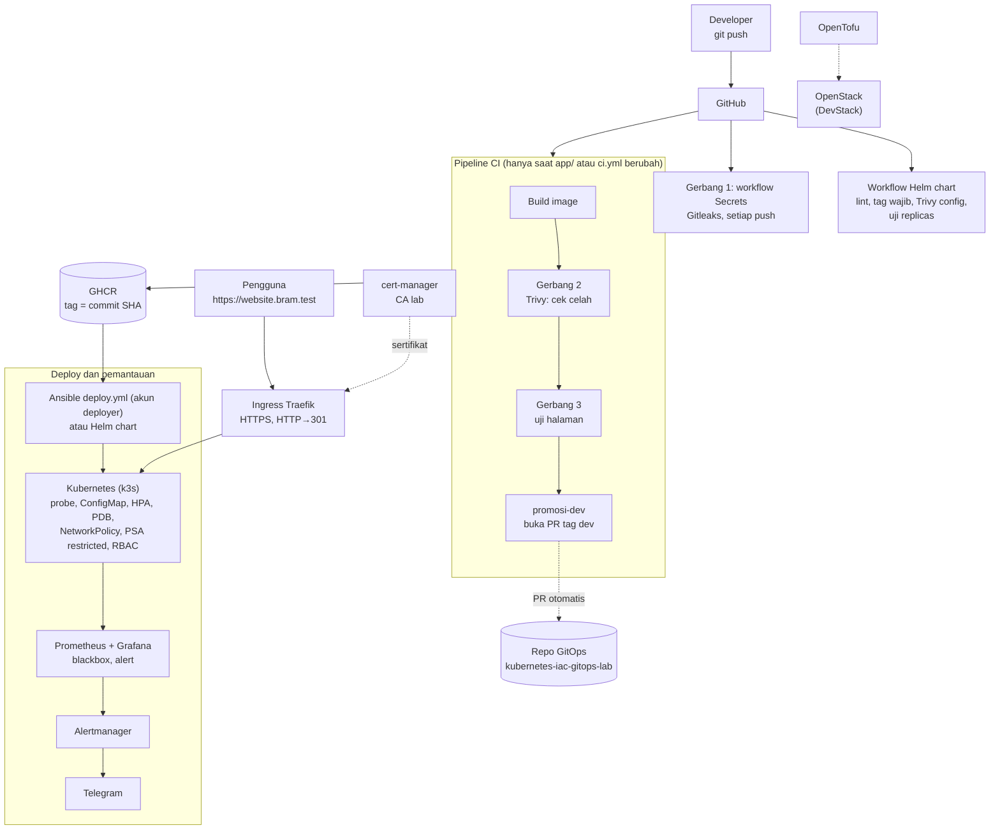
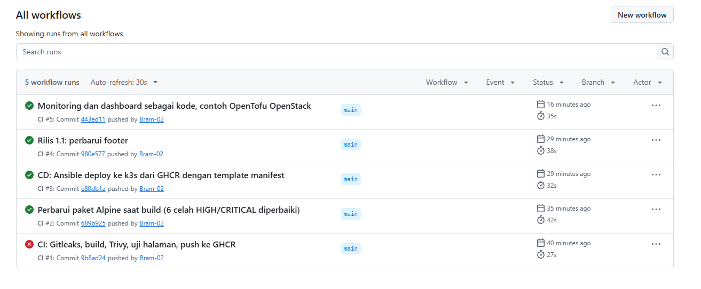
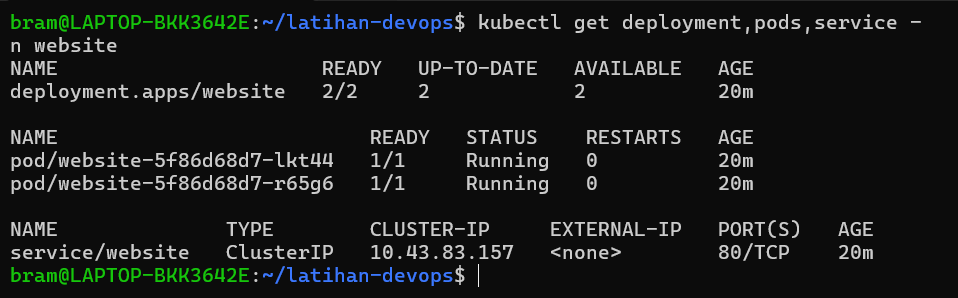
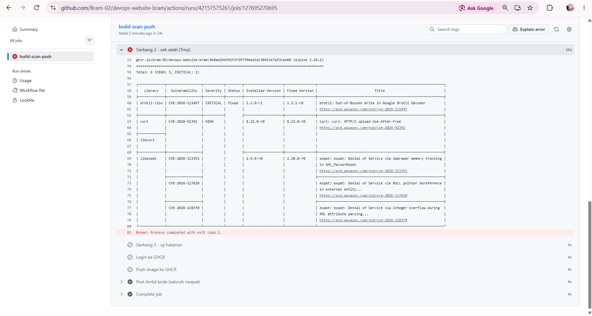
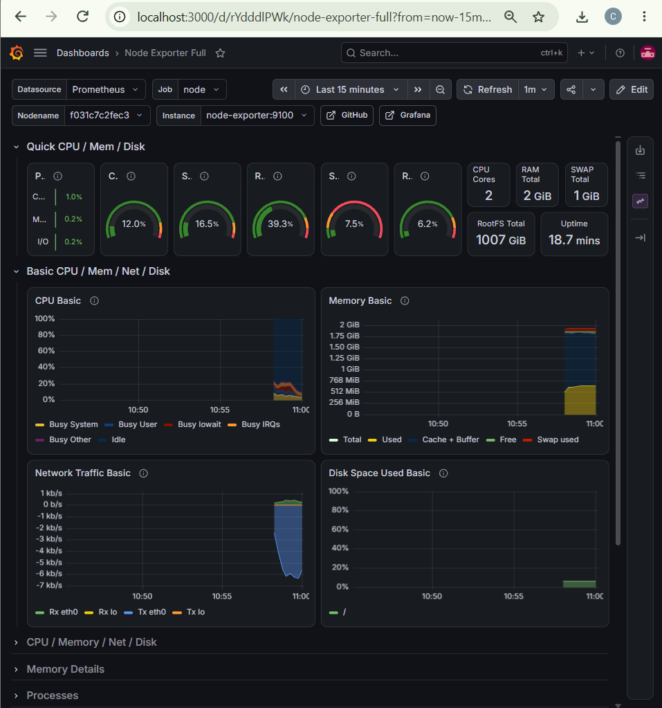

# DevOps Website Bram


Proyek DevOps end-to-end: sebuah website sederhana yang dibangun, diperiksa keamanannya, disimpan di registry, lalu di-deploy ke Kubernetes secara otomatis dan bisa di-rollback dengan satu perintah. Website dibuka lewat HTTPS di Ingress (Traefik) dengan sertifikat yang diterbitkan dan diperpanjang otomatis oleh cert-manager (akses HTTP dialihkan ke HTTPS), dijaga readiness dan liveness probe, jumlah pod menyesuaikan beban dengan HPA, tetap tersedia saat perawatan node berkat PodDisruptionBudget, jaringannya dibatasi NetworkPolicy (hanya Traefik yang boleh masuk, tidak ada koneksi keluar), namespace-nya hanya menerima pod yang memenuhi standar Pod Security *restricted*, deploy memakai ServiceAccount berhak minimum (bukan admin cluster), isi konfigurasinya diambil dari ConfigMap, dan seluruh manifest juga tersedia sebagai Helm chart yang diperiksa di CI dan bisa di-deploy secara GitOps oleh Argo CD. Kondisi server dipantau dengan Prometheus dan Grafana, website diperiksa dari luar oleh blackbox exporter dengan alert ketika mati atau sertifikat hampir habis yang dikirim Alertmanager ke Telegram (konfigurasi dan aturan alert diuji otomatis di CI), dan contoh infrastruktur private cloud ditulis dengan OpenTofu.

> **English summary:** End-to-end DevOps project. Every `git push` runs a Gitleaks secret scan; pushes that change the application run a GitHub Actions pipeline (Trivy vulnerability scan, page test) before the image is pushed to GitHub Container Registry, tagged with the commit SHA. After a successful build, CI opens a pull request in the [GitOps repository](https://github.com/Bram-02/kubernetes-iac-gitops-lab) that bumps the dev image tag (a fine-grained, single-repository token), so a human only reviews and merges. Deploys use the tag of the last commit that touched `app/`, so documentation or manifest changes never rebuild the image or restart pods, and the playbook uses `kubectl diff` to report real changes only and to repair drift. Ansible deploys a specific version to a hardened Kubernetes (k3s) deployment with rolling updates and one-command rollback, readiness/liveness probes, a ConfigMap, and a Traefik Ingress served over HTTPS with certificates issued and renewed automatically by cert-manager (from a name-constrained lab CA, installed by a separate idempotent platform playbook); plain HTTP is redirected with a 301. A HorizontalPodAutoscaler scales the website from 2 to 5 pods on CPU (verified with a load test), and a PodDisruptionBudget keeps at least one pod serving during voluntary disruptions (verified through the Eviction API). NetworkPolicies deny all traffic by default: only the Traefik ingress controller may reach the pods, and the pods cannot open outbound connections. Pod Security Admission enforces the *restricted* standard (version pinned) on the namespace. Deploys run as a least-privilege ServiceAccount (namespace-scoped RBAC, 24-hour token) instead of a cluster admin, while the namespace, PSA labels and NetworkPolicies are owned by a separate platform playbook. A deploy only counts as successful when the cert-manager Certificate is Ready and has at least 7 days left (configurable); the deployer can read Certificate status but not the Secret holding the private key. The same manifests are packaged as a Helm chart (HPA, PDB and NetworkPolicy can be toggled per environment), validated in a separate CI workflow (helm lint, a regression test that the chart refuses to render without an image tag, a Trivy config scan, and a regression test that the Deployment never sets replicas while the HPA is enabled), and is also deployed GitOps-style by Argo CD using an app-of-apps pattern. Monitoring (Prometheus, node-exporter, Grafana) and its dashboards are provisioned as code; a blackbox exporter probes the site over HTTPS with alert rules for downtime and certificate expiry, verified by a simulated outage (alert fired about 1 minute after the site went down), and Alertmanager sends firing and resolved notifications to Telegram with the bot token and chat ID kept outside the repository. Monitoring images are pinned to exact versions, and a separate CI workflow validates the Prometheus, Alertmanager and blackbox configurations with those same versions and runs `promtool` unit tests for the alert rules (including a 30-second blip that must not page anyone). Alerts are routed by severity: critical alerts notify loudly and repeat hourly, warnings arrive silently and repeat daily, and the routing tree itself is tested with `amtool config routes test`. The Ansible playbooks pass ansible-lint at the strictest `production` profile in their own CI workflow, with the lint version and the `kubernetes.core` collection pinned. An OpenTofu example provisions an instance on a private OpenStack (DevStack) cloud.

**Penyusun:** Bram Naibaho, D3 Teknologi Komputer, Institut Teknologi Del

---

## Arsitektur



| Tahap | Alat | Fungsi |
| --- | --- | --- |
| Kode | Git, GitHub | Semua kode, konfigurasi, dan dashboard disimpan di repository ini |
| CI | GitHub Actions | Cek rahasia di setiap `git push`; build dan uji image hanya saat kode aplikasi berubah; setelah lolos, membuka PR otomatis ke repo GitOps untuk lingkungan dev |
| Keamanan | Gitleaks, Trivy | Pipeline gagal kalau ada rahasia bocor atau celah HIGH/CRITICAL yang bisa diperbaiki |
| Container | Docker, nginx-unprivileged | Website berjalan tanpa root, di port 8080, dengan HEALTHCHECK |
| Registry | GitHub Container Registry | Image disimpan dengan tag `latest` dan tag commit SHA |
| Deploy | Ansible, Kubernetes (k3s) | Deploy versi tertentu, rolling update, rollback satu perintah |
| Ketahanan | Readiness dan liveness probe | Versi yang rusak tertahan saat rolling update, container macet di-restart otomatis |
| Konfigurasi | ConfigMap | Isi halaman `/info/` berubah tanpa build image dan tanpa restart pod |
| Akses | Ingress (Traefik) | Website dibuka lewat nama alamat, tanpa `port-forward` |
| HTTPS | cert-manager, CA lab, Middleware Traefik | Sertifikat diterbitkan otomatis dari anotasi Ingress, berlaku 90 hari, diperpanjang otomatis; HTTP dialihkan ke HTTPS (301) |
| Skala | HorizontalPodAutoscaler | 2 sampai 5 pod mengikuti beban CPU (target 50% dari requests) |
| Ketersediaan | PodDisruptionBudget | Minimal 1 pod tetap melayani saat drain atau upgrade node |
| Admission | Pod Security Admission | Namespace `restricted` (enforce, warn, audit, versi dikunci v1.37): pod root atau tanpa seccomp ditolak API server |
| Jaringan | NetworkPolicy | Tolak semua secara default; hanya Traefik yang boleh masuk ke port 8080, pod tidak boleh membuka koneksi keluar |
| Paket | Helm, Argo CD | Chart 0.3.0 dengan HPA, PDB, dan NetworkPolicy yang bisa dimatikan per lingkungan; riwayat revisi dan rollback; 4 gerbang CI; bisa di-deploy GitOps oleh Argo CD |
| Hak akses | RBAC, ServiceAccount | Deploy memakai akun `deployer` yang hanya mengelola objek aplikasi di namespace `website`, token 24 jam; boleh membaca status sertifikat, tidak boleh membaca Secret |
| Monitoring | Prometheus, node-exporter, Grafana, blackbox exporter | Data source dan dashboard dari file; probe HTTPS dari luar dengan alert `WebsiteMati` dan `SertifikatHampirHabis`, dikirim Alertmanager ke Telegram; rute per severity (critical berbunyi, warning senyap); versi image dikunci, konfigurasi, unit test, dan rute alert diperiksa di CI |
| Infrastruktur | OpenTofu, OpenStack | Contoh membuat instance di private cloud dari kode |

---

## Hasil keamanan

| Pemeriksaan | Sebelum | Sesudah | Cara |
| --- | --- | --- | --- |
| Rahasia di riwayat Git (Gitleaks) | - | 0 kebocoran | `.gitignore`, password di `.env` dan `clouds.yaml` di luar repository |
| Celah HIGH/CRITICAL image (Trivy) | 66 | 0 | Base image Debian diganti Alpine |
| Celah yang ditangkap gerbang CI | 6 (1 CRITICAL) | 0 | `apk upgrade` saat build |
| Temuan konfigurasi Dockerfile | 2 | 0 | `USER` non-root dan `HEALTHCHECK` |
| Temuan konfigurasi Kubernetes | 19 | 1 | securityContext, batas CPU/RAM, namespace sendiri |
| Temuan HIGH/CRITICAL di Helm chart | - | 0 | Diperiksa Trivy di workflow Helm chart setiap ada perubahan chart |
| Hak kunci deploy | Admin cluster (`system:masters`) | Hanya namespace `website`, tanpa Secret, NetworkPolicy, dan Namespace | Role `deployer`; diuji dengan `kubectl auth can-i --as` dan percobaan apply yang ditolak |
| Pod yang melanggar standar restricted | Diterima | Ditolak | Pod Security Admission; diuji dengan pod dan Deployment busybox biasa |
| Akses jaringan ke pod website | Semua pod di cluster | Hanya Traefik | NetworkPolicy; diuji dengan pod dari namespace lain dan pod yang menyamar dengan label Traefik |

Sisa satu temuan (KSV-0125, registry publik) diterima secara sadar untuk lingkungan lab. Di lingkungan perusahaan, image disimpan di registry privat yang diizinkan.

---

## Struktur repository

```
.
├── .github/workflows/
│   ├── secrets.yml                 # Gitleaks di setiap push
│   ├── ci.yml                      # Hanya saat app/ berubah: build, Trivy, uji, push ke GHCR, lalu PR otomatis ke repo GitOps
│   ├── helm.yml                    # Gerbang chart: helm lint, tag wajib, Trivy config, uji replicas
│   ├── monitoring.yml              # Saat monitoring/ berubah: menjalankan monitoring/cek-konfigurasi.sh
│   └── ansible.yml                 # Saat ansible/ berubah: menjalankan ansible/lint.sh
├── .github/scripts/
│   └── cek-replicas.sh             # Uji regresi: replicas tidak ditulis saat HPA aktif (bisa dijalankan lokal)
├── app/
│   ├── Dockerfile                  # nginx tanpa root, port 8080, HEALTHCHECK
│   └── index.html
├── k8s/
│   ├── website.yaml.j2             # Lapisan aplikasi (deployer): Deployment, Service, ConfigMap, Middleware, Ingress + TLS, HPA, PDB
│   ├── namespace-website.yaml      # Lapisan platform (admin): Namespace + label PSA, NetworkPolicy
│   ├── rbac.yaml                   # ServiceAccount, Role, RoleBinding deployer (baca Certificate, tanpa Secret)
│   └── cluster-issuer.yaml         # ClusterIssuer cert-manager (CA lab)
├── helm/website/                   # Helm chart 0.3.0: Deployment, Service, ConfigMap, Ingress, HPA, PDB, NetworkPolicy
├── ansible/
│   ├── inventory.ini
│   ├── requirements.yml            # Koleksi kubernetes.core 2.4.0 (versi dikunci)
│   ├── lint.sh                     # ansible-lint 26.11.0 profil production di dalam container
│   ├── platform.yml                # Lapisan platform (admin): cert-manager, CA lab, ClusterIssuer, namespace, NetworkPolicy, RBAC
│   ├── token-deployer.yml          # Menerbitkan kubeconfig deployer dengan token 24 jam
│   └── deploy.yml                  # Lapisan aplikasi (deployer): isi template, kubectl diff, apply bila beda, tunggu rollout dan sertifikat Ready
├── monitoring/
│   ├── compose.yaml                # node-exporter, Prometheus, Grafana, blackbox exporter, Alertmanager (versi dikunci)
│   ├── prometheus.yml              # Target scrape, probe HTTPS (relabeling ke blackbox), file aturan
│   ├── blackbox.yml                # Modul https_website: wajib HTTPS 200, TLS diverifikasi dengan CA lab
│   ├── alerts.yml                  # Alert WebsiteMati dan SertifikatHampirHabis
│   ├── alerts_test.yml             # Unit test aturan alert (promtool test rules), 4 skenario
│   ├── cek-konfigurasi.sh          # promtool, unit test, amtool, uji rute, blackbox --config.check (versi dari compose.yaml)
│   ├── alertmanager.yml.tmpl       # Rute per severity ke Telegram; chat_id disisipkan saat render (alertmanager.yml diabaikan Git)
│   ├── siapkan-alertmanager.sh     # Membuat alertmanager.yml dari template dan ~/.secrets
│   └── grafana/                    # Data source dan dashboard sebagai kode
└── infra/opentofu-openstack/       # Contoh instance OpenStack dengan OpenTofu
```

---

## Cara menjalankan

### Prasyarat

- Linux (diuji di Ubuntu 24.04 di WSL2) dengan Docker, Ansible, dan k3s
- `kubectl` dapat mengakses cluster melalui `~/.kube/config`

### 1. Uji aplikasi secara lokal

```bash
docker build -t devops-website-bram:local ./app
docker run -d --name uji -p 8080:8080 devops-website-bram:local
curl -s http://localhost:8080 | grep "<title>"
docker rm -f uji
```

### 2. Platform: HTTPS dengan cert-manager

Buat CA lab sekali saja, di luar repository. CA ini dibatasi (*name constraints*) hanya untuk `bram.test`, sehingga tidak bisa dipakai memalsukan situs lain:

```bash
mkdir -p ~/lab-ca && chmod 700 ~/lab-ca && cd ~/lab-ca
openssl req -x509 -newkey rsa:2048 -nodes -keyout ca.key -out ca.crt -days 365 \
  -subj "/CN=Bram Lab CA" \
  -addext "basicConstraints=critical,CA:TRUE" \
  -addext "keyUsage=critical,keyCertSign,cRLSign" \
  -addext "nameConstraints=critical,permitted;DNS:bram.test"
chmod 600 ca.key
```

Pasang cert-manager, Secret CA, ClusterIssuer, namespace `website` (label PSA, NetworkPolicy), dan RBAC `deployer` dengan akun admin (idempoten), lalu terbitkan kubeconfig `deployer`:

```bash
cd ansible
ansible-playbook -i inventory.ini platform.yml -K
ansible-playbook -i inventory.ini token-deployer.yml      # ~/.kube/deployer, token 24 jam
```

Token `deployer` kedaluwarsa setelah 24 jam. Jika deploy gagal dengan `Unauthorized`, jalankan lagi `token-deployer.yml`. Kunci ini hanya bisa mengelola objek aplikasi di namespace `website`:

```bash
SA=system:serviceaccount:website:deployer
kubectl auth can-i patch deployments -n website --as=$SA        # yes
kubectl auth can-i get secrets -n website --as=$SA              # no
kubectl auth can-i delete networkpolicies -n website --as=$SA   # no
```

Agar browser Windows percaya, impor `ca.crt` (bukan `ca.key`) ke daftar CA akun Windows, dan cocokkan thumbprint dengan `openssl x509 -in ~/lab-ca/ca.crt -noout -fingerprint -sha1` sebelum menyetujui:

```bash
cp ~/lab-ca/ca.crt /mnt/c/Users/<user>/Downloads/bram-lab-ca.crt
powershell.exe -NoProfile -Command 'Import-Certificate -FilePath "$env:USERPROFILE\Downloads\bram-lab-ca.crt" -CertStoreLocation Cert:\CurrentUser\Root'
```

Setelah selesai berlatih, hapus lagi CA ini dari Windows:

```bash
powershell.exe -NoProfile -Command 'Get-ChildItem Cert:\CurrentUser\Root | Where-Object Subject -eq "CN=Bram Lab CA" | Remove-Item'
```

### 3. Deploy ke Kubernetes (versi tertentu)

Setiap image di GHCR diberi tag commit SHA. Yang di-deploy adalah commit terakhir yang mengubah `app/`, dan image-nya dicek dulu di registry (CI butuh beberapa menit setelah push):

```bash
TAG=$(git log -1 --format=%H -- app/)
docker manifest inspect ghcr.io/bram-02/devops-website-bram:$TAG > /dev/null && echo "image ada"
cd ansible
ansible-playbook -i inventory.ini deploy.yml -K -e image_tag=$(git log -1 --format=%H -- app/)
# Sertifikat website-tls Ready, berlaku sampai ... (N hari lagi); tambahkan -e batas_hari_sertifikat=30 untuk batas yang lebih ketat
curl -s http://website.localhost/ | grep "<title>"
curl -s http://website.localhost/info/
curl -sI http://website.bram.test/ | head -3      # 301, Location: https://website.bram.test/
```

Website dilayani Ingress Traefik bawaan k3s; `https://website.bram.test` memakai sertifikat dari cert-manager. Untuk membukanya dari browser Windows (WSL2), arahkan `website.bram.test` ke IP WSL di file hosts Windows. IP-nya terlihat di kolom EXTERNAL-IP:

```bash
kubectl get svc -n kube-system traefik
```

```
# C:\Windows\System32\drivers\etc\hosts (dibuka sebagai Administrator)
<EXTERNAL-IP>    website.bram.test
```

### 3b. Uji autoscaling (HPA) dan PodDisruptionBudget

Jumlah pod dipegang HPA (2 sampai 5, target CPU 50%), jadi Deployment tidak menulis `replicas`. Beri beban lalu amati:

```bash
kubectl run beban -n website --image=busybox:1.36 --restart=Never -- /bin/sh -c \
  'for i in 1 2 3 4 5 6; do (while true; do wget -q -O /dev/null http://website; done) & done; wait'
kubectl get hpa -n website -w            # CPU naik, pod 2 → 5 dalam sekitar 30 detik
kubectl delete pod beban -n website      # pod kembali ke 2 setelah stabilization window (sekitar 5 menit)
```

PodDisruptionBudget (`minAvailable: 1`) diuji lewat Eviction API, jalur yang sama dengan `kubectl drain`:

```bash
usir() { printf '{"apiVersion":"policy/v1","kind":"Eviction","metadata":{"name":"%s","namespace":"website"}}' "$1" \
  | kubectl create --raw "/api/v1/namespaces/website/pods/$1/eviction" -f - ; echo; }
P1=$(kubectl get pods -n website -l app=website -o jsonpath='{.items[0].metadata.name}')
P2=$(kubectl get pods -n website -l app=website -o jsonpath='{.items[1].metadata.name}')
usir "$P1"; usir "$P2"     # pertama 201 Success, kedua 429 TooManyRequests
```

### 4. Rollback

Kembali ke versi sebelumnya cukup dengan mengganti tag:

```bash
ansible-playbook -i inventory.ini deploy.yml -K -e image_tag=$(git log -2 --format=%H -- app/ | tail -n 1)
```

Kubernetes mengganti pod secara bertahap (rolling update), jadi website tidak mati selama pergantian. Readiness probe memastikan pod lama baru dimatikan setelah pod baru benar-benar siap.

### 4b. Alternatif: deploy dengan Helm

```bash
helm install website helm/website -n website-helm --create-namespace \
  --set image.tag=$(git log -1 --format=%H -- app/) --wait
helm upgrade website helm/website -n website-helm --set image.tag=$(git log -1 --format=%H -- app/) \
  --set autoscaling.enabled=false --set replicaCount=3 --wait
helm history website -n website-helm
helm rollback website 1 -n website-helm --wait
helm uninstall website -n website-helm
```

Chart menolak dipasang tanpa `image.tag`, supaya tidak ada deploy tanpa versi yang jelas. Fitur bisa dimatikan per lingkungan:

| Nilai | Bawaan | Kapan dimatikan |
| --- | --- | --- |
| `ingress.enabled` | `true` | Cluster tanpa ingress controller |
| `autoscaling.enabled` | `true` | Cluster tanpa metrics-server (misalnya kind); `replicaCount` hanya dipakai saat ini `false` |
| `podDisruptionBudget.enabled` | `true` | Lingkungan dengan 1 replika (PDB `minAvailable: 1` akan menahan drain selamanya) |
| `networkPolicy.enabled` | `true` | Cluster tanpa penegak NetworkPolicy; label ingress controller diatur di `networkPolicy.ingressController` |

Berbeda dengan manifest Ansible yang mengunci seluruh namespace, NetworkPolicy di chart hanya memilih pod milik release, karena chart bisa dipasang di namespace bersama. Label Pod Security dipasang di namespace, bukan di chart (untuk Argo CD lewat `managedNamespaceMetadata`).

### 4c. Alternatif: GitOps dengan Argo CD

Chart yang sama di-deploy oleh Argo CD dari repository ini, dengan pola *app of apps* (Application `root` dipasang OpenTofu, Application lain cukup berupa file YAML di Git). Contohnya ada di repository [kubernetes-iac-gitops-lab](https://github.com/Bram-02/kubernetes-iac-gitops-lab), folder `week11/`.

Setelah image lolos semua gerbang, job `promosi-dev` di `ci.yml` meng-clone repo GitOps itu, mengganti `newTag` di overlay dev, lalu membuka pull request (commit atas nama `github-actions[bot]`, deskripsi berisi image dan tautan run CI). Manusia cukup me-review dan merge; promosi ke prod tetap lewat PR terpisah dengan tag yang sama. Job ini memakai secret `GITOPS_TOKEN`, yaitu *fine-grained personal access token* yang hanya berlaku untuk repo GitOps, hanya izin Contents dan Pull requests, dan kedaluwarsa dalam 30 hari.

### 5. Monitoring

```bash
cd monitoring
read -s -p "Password admin Grafana: " PW; echo "GF_SECURITY_ADMIN_PASSWORD=$PW" > .env; unset PW
chmod 600 .env
docker compose up -d
```

- Grafana: `http://localhost:3000` (user `admin`), dashboard **Node Exporter Full** langsung tersedia
- Prometheus: `http://localhost:9090/targets`, aturan alert di `http://localhost:9090/alerts`

Blackbox exporter memeriksa `https://website.bram.test/` dari luar (lewat `host-gateway`, sertifikat diverifikasi dengan `~/lab-ca/ca.crt`). Periksa konfigurasi sebelum dijalankan, lalu uji alert dengan mematikan website sementara:

```bash
./cek-konfigurasi.sh        # sintaks Prometheus, unit test alert, Alertmanager, rute alert, blackbox (sama dengan CI)
kubectl scale deployment website -n website --replicas=0    # WebsiteMati: pending, lalu firing setelah 1 menit
kubectl scale deployment website -n website --replicas=2    # alert kembali inactive
```

Alertmanager mengirim notifikasi ke Telegram (🔥 saat menyala, ✅ saat pulih). Token bot dan chat ID disimpan di `~/.secrets` (izin 700), bukan di repository; yang di-commit hanya template:

```bash
mkdir -p ~/.secrets && chmod 700 ~/.secrets
read -s -p "Token bot dari @BotFather: " T; printf '%s' "$T" > ~/.secrets/telegram_bot_token; unset T; echo
chmod 644 ~/.secrets/telegram_bot_token     # dibaca container sebagai user nobody
read -p "Chat ID: " C; printf '%s' "$C" > ~/.secrets/telegram_chat_id; unset C
./siapkan-alertmanager.sh                  # membuat alertmanager.yml (diabaikan Git)
docker compose up -d
docker exec alertmanager amtool alert add alertname=Uji severity=info instance=uji \
  --annotation='summary="Alert uji"' --alertmanager.url=http://localhost:9093   # uji format pesan tanpa mematikan website
docker exec alertmanager amtool config routes --alertmanager.url=http://localhost:9093   # pohon rute yang sedang berjalan
```

| Severity | Contoh alert | Receiver | Bunyi | Diulang |
| --- | --- | --- | --- | --- |
| `critical` | `WebsiteMati` | `telegram` | Ya | Tiap 1 jam sampai pulih |
| `warning` | `SertifikatHampirHabis` | `telegram-senyap` (`disable_notifications`) | Tidak | Sekali sehari |
| lainnya | alert baru tanpa rute khusus | `telegram` (rute induk) | Ya | Tiap 4 jam |

Rute diuji di CI (`amtool config routes test --verify.receivers`) dan sungguhan: alert uji critical masuk sekitar 10 detik setelah dikirim, warning sekitar 1 menit (`group_wait`), lalu keduanya mengirim pesan pulih.

### 6. Infrastruktur OpenStack (opsional)

Membutuhkan OpenStack (misalnya DevStack) dan kredensial di `~/.config/openstack/clouds.yaml`, yang tidak disimpan di repository.

```bash
cd infra/opentofu-openstack
tofu init
tofu plan
tofu apply
```

---

## Keputusan desain

- **Tag image = commit SHA, bukan `latest`.** Tag `latest` tidak memicu update di Kubernetes karena namanya tidak berubah, tidak bisa dilacak, dan tidak bisa di-rollback dengan pasti. Commit SHA unik untuk setiap versi.
- **Gerbang keamanan di CI.** Image yang membawa rahasia atau celah HIGH/CRITICAL yang sudah ada perbaikannya tidak pernah sampai ke registry. Opsi `--ignore-unfixed` dipakai agar rilis tidak terblokir oleh celah yang belum punya perbaikan.
- **Least privilege.** Container berjalan sebagai user biasa, sistem file hanya-baca, semua capability Linux dicabut, dan setiap pod dibatasi CPU dan RAM-nya.
- **Readiness dan liveness probe.** Kubernetes tidak memakai `HEALTHCHECK` dari Dockerfile, jadi kesehatan pod diperiksa dengan probe. Saat diuji dengan probe yang sengaja dirusak, rolling update berhenti dan versi lama tetap melayani (HTTP 200).
- **Konfigurasi terpisah dari image.** ConfigMap dipasang sebagai volume sehingga perubahan isinya sampai ke pod tanpa restart. Secret tidak pernah ditulis di Git, karena isinya hanya di-encode base64, bukan dienkripsi.
- **Versi dikunci.** Runner CI memakai `ubuntu-24.04`, bukan `ubuntu-latest`, dan action memakai versi mayor yang jelas, supaya pipeline tidak berubah tanpa disadari.
- **HTTPS dengan CA lab yang dibatasi.** Domain `.test` tidak bisa memakai Let's Encrypt, jadi dipakai CA sendiri dengan *name constraints* `bram.test`, kunci CA berizin 600 di luar repository, dan dipercaya hanya di akun Windows pengguna. Mekanismenya sama dengan production: cert-manager menerbitkan dan memperpanjang sertifikat dari anotasi Ingress.
- **HTTP dipaksa ke HTTPS, per Ingress.** Middleware Traefik `redirectScheme` berlaku untuk semua host di satu Ingress, jadi Ingress dipisah: `website` (website.bram.test, TLS, redirect) dan `website-local` (website.localhost, HTTP). Nama `website` dipertahankan karena Certificate `website-tls` dimiliki Ingress itu.
- **Satu objek, satu pemilik: replika dipegang HPA.** `replicas` dihapus dari Deployment supaya setiap deploy tidak menimpa keputusan HPA. HPA naik cepat dan turun lambat (stabilization window 5 menit) untuk mencegah flapping.
- **PDB untuk gangguan yang disengaja.** `minAvailable: 1` membuat drain atau upgrade mengusir pod satu per satu dan menunggu pengganti siap. PDB tidak menahan `kubectl delete pod` atau node yang mati mendadak; untuk itu tetap dibutuhkan lebih dari satu replika.
- **NetworkPolicy: tolak semua, buka yang perlu.** `tolak-semua-masuk` dan `tolak-semua-keluar` berlaku untuk seluruh namespace; `izinkan-traefik` hanya membuka port 8080 untuk pod Traefik di `kube-system` (namespaceSelector DAN podSelector dalam satu item, sehingga label palsu di namespace lain tetap ditolak). Website statis tidak butuh koneksi keluar, jadi Egress ditutup total; aplikasi yang butuh DNS harus membuka port 53 ke kube-dns.
- **Image hanya dibangun saat aplikasi berubah, rahasia tetap dicek setiap push.** Gitleaks dipisah ke `secrets.yml` tanpa filter, sedangkan `ci.yml` memakai `paths` (`app/**`, `ci.yml`). Deploy dan rollback memakai `git log -1 --format=%H -- app/`, sehingga perubahan README, manifest, atau playbook tidak mengganti pod.
- **Idempotensi yang jujur.** `deploy.yml` menjalankan `kubectl diff` dulu: kode 0 berarti apply dilewati (`changed=0`), kode 1 berarti perbedaan dicetak ke log lalu di-apply. Perubahan manual di cluster (drift) terdeteksi dan dipulihkan.
- **Pod Security Admission dengan versi dikunci.** Namespace diberi label `enforce`, `warn`, dan `audit` = `restricted`, semuanya `v1.37`, supaya upgrade cluster tidak mengubah aturan diam-diam. `enforce` hanya memeriksa Pod: Deployment yang melanggar tetap diterima tetapi `0/1` dengan event `FailedCreate`, sehingga `warn` dipasang agar masalahnya terlihat saat apply.
- **Uji regresi yang diuji.** Gerbang 4 (`cek-replicas.sh`) dijalankan terhadap chart yang benar (lulus) dan salinan chart yang sengaja dirusak (gagal), sehingga terbukti bisa menangkap kesalahan.
- **Deploy sukses berarti HTTPS sehat.** Pod yang lulus probe belum tentu bisa dibuka pengunjung: kalau sertifikat gagal terbit atau hampir habis, browser menolak. Setelah rollout, `deploy.yml` menunggu Certificate `website-tls` Ready (`kubectl wait`) dan menolak deploy bila sisa masa berlakunya kurang dari `batas_hari_sertifikat` (bawaan 7 hari), lapisan kedua di bawah alert `SertifikatHampirHabis` (14 hari). Untuk itu `deployer` diberi `get/list/watch` pada `certificates.cert-manager.io` saja; `delete`, `patch`, `create`, dan akses ke Secret (tempat kunci privat) tetap ditolak, dibuktikan dengan `kubectl auth can-i --as`. Uji batas 100 hari membuat deploy gagal (kode keluar 2).
- **Deploy dengan hak minimum.** Pipeline deploy memakai ServiceAccount `deployer` (Role di namespace `website`), bukan `system:masters` yang bisa menghapus `kube-system`. Pagar keamanan (Namespace, label PSA, NetworkPolicy, RBAC) dimiliki lapisan platform dan bahkan tidak bisa dibaca `deployer`, sehingga kunci deploy yang bocor tidak bisa melonggarkannya. Token berumur 24 jam dan diterbitkan ulang dengan `token-deployer.yml`; kesiapan cluster dicek lewat `/readyz` yang tidak butuh hak atas node.
- **Alert dari sudut pandang pengunjung.** Blackbox exporter memeriksa HTTPS, kode 200, dan masa berlaku sertifikat. `WebsiteMati` memakai `for: 1m` agar gangguan sesaat tidak memicu alert palsu; pada uji mati-pulih alert menyala sekitar 1 menit setelah website mati dan padam saat pulih.
- **Mesin mengusulkan, manusia memutuskan.** CI tidak men-deploy langsung ke cluster dan tidak memegang kredensial cluster; ia hanya membuka PR ke repo GitOps dengan token berhak minimum. Merge adalah gerbang deploy, dan riwayat Git membedakan commit otomatis (`github-actions[bot]`) dari keputusan manusia.
- **Playbook juga punya gerbang.** Playbook adalah kode yang menyentuh cluster, jadi `ansible/lint.sh` menjalankan ansible-lint profil `production` (paling ketat) di CI. Lint pertama menemukan dua hal yang bermakna: koleksi `kubernetes.core` yang dipakai `platform.yml` tidak tercatat (playbook hanya jalan di laptop yang kebetulan punya koleksinya), kini dicatat di `requirements.yml` dengan versi yang terbukti jalan; dan pipa `kubectl create ... | kubectl apply` tanpa `pipefail`, sehingga kegagalan perintah pertama tertutup oleh perintah kedua, kini memakai `set -o pipefail` dengan `/bin/bash` (dash, `/bin/sh` bawaan Ubuntu, tidak mengenalnya).
- **Konfigurasi monitoring diuji seperti kode.** `promtool check` hanya memeriksa tata bahasa; `promtool test rules` memeriksa perilaku dengan data palsu: website mati 2 menit harus memicu `WebsiteMati`, gangguan 30 detik tidak boleh, sertifikat 10 hari harus memicu `SertifikatHampirHabis` dengan pesan yang tepat. Uji ini terbukti menangkap `for: 1m` yang diubah menjadi `5m`, dan PR dengan PromQL rusak ditandai merah oleh workflow Monitoring. Versi image monitoring dikunci (bukan `latest`) dan skrip pemeriksa membacanya dari `compose.yaml`, sehingga CI menguji versi yang sama dengan yang berjalan.
- **Notifikasi tanpa rahasia di Git.** Token bot dibaca Alertmanager lewat `bot_token_file`; chat ID disisipkan saat render. `send_resolved` memberi kabar saat pulih.
- **Bunyi hanya untuk yang mendesak.** Alert dirutekan berdasarkan label `severity`: `critical` (pengunjung terdampak sekarang) berbunyi dan diulang tiap jam, `warning` (masih ada waktu berhari-hari) masuk tanpa bunyi dan diulang sehari sekali. Kalau semua alert berbunyi, orang belajar mengabaikannya (*alert fatigue*). Receiver senyap mewarisi pengaturan receiver utama lewat anchor YAML, sehingga template pesan hanya ditulis sekali. Uji rute di CI terbukti menangkap warning yang salah diarahkan ke receiver berbunyi.
- **Platform terpisah dari aplikasi.** `platform.yml` (cert-manager, CA, ClusterIssuer) jarang berubah, sedangkan `deploy.yml` (website) sering berubah. Keduanya idempoten: run kedua `changed=0`.
- **Semua sebagai kode.** Manifest, playbook, konfigurasi monitoring, data source, dan dashboard Grafana disimpan di Git; rahasia tidak.

---

## Kendala yang dihadapi

| Kendala | Penyebab | Solusi |
| --- | --- | --- |
| Pipeline merah di run pertama | Trivy menemukan 6 celah di image dasar `nginx-unprivileged` (Alpine 3.24.2) | `apk upgrade --no-cache` saat build, diuji lokal dengan perintah yang sama sebelum push |
| Versi baru tidak ter-deploy | Manifest tetap memakai tag `latest`, sehingga `kubectl apply` menilai tidak ada perubahan | Deploy dengan tag commit SHA |
| Trivy timeout | Unduhan database pertama melebihi batas 5 menit | `--timeout 15m` dan cache di volume |
| Website tidak bisa dibuka dari browser Windows | WSL hanya meneruskan `localhost` untuk program yang LISTEN, sedangkan port 80 Traefik dibuat lewat iptables (dibuktikan dengan `ss -tlnp` dan `curl.exe`) | Nama `website.bram.test` di file hosts Windows diarahkan ke IP WSL, ditambahkan sebagai host kedua di Ingress |
| Baris baru di file hosts menempel ke baris sebelumnya | Baris terakhir file tidak diakhiri newline | Cadangkan file, rapikan di Notepad, akhiri file dengan baris baru |
| Peringatan Node.js 20 dan `ubuntu-latest` di GitHub Actions | Action versi lama dan label runner yang berpindah versi | Naikkan ke `actions/checkout@v5` dan `azure/setup-helm@v5`, kunci runner ke `ubuntu-24.04` |
| kubectl mencoba `localhost:8080` setelah latihan kind | kind ikut menulis ke `~/.kube/config` lalu meninggalkan `current-context` kosong saat dihapus | Pulihkan dari `/etc/rancher/k3s/k3s.yaml`, simpan cadangan, dan pakai kubeconfig terpisah untuk cluster lain |
| `curl.exe` di Windows: `CRYPT_E_NO_REVOCATION_CHECK` | CA lab tidak menyediakan informasi pencabutan (CRL/OCSP) | Rantai kepercayaan terbukti benar dengan `--ssl-no-revoke`; browser menerima sertifikat |
| Replika sempat turun ke 1 saat HPA dipasang | `replicas` dihapus dari manifest; `kubectl apply` menghapus field itu dan Kubernetes memakai nilai bawaan 1 sampai HPA menaikkannya lagi ke 2 | Di production, lepas kepemilikan field dulu dengan `kubectl apply set-last-applied` atau `edit-last-applied` sebelum menghapus `replicas` |
| Ingress 502 setelah NetworkPolicy tolak semua, padahal pod 1/1 | Traefik ikut diblokir; probe tetap lulus karena dikirim kubelet dari node | Tambah `izinkan-traefik`; 502 dengan pod sehat adalah tanda untuk memeriksa NetworkPolicy |
| Commit README memicu build image dan rolling update | CI berjalan di setiap push dan deploy memakai tag HEAD | `paths` di `ci.yml`, Gitleaks dipisah ke `secrets.yml`, tag deploy dari commit terakhir yang mengubah `app/` |
| Playbook selalu `changed=1` | `kubectl apply` selalu melaporkan PDB `configured` (selector memakai patchStrategy replace), padahal `resourceVersion` tidak berubah | `kubectl diff` menentukan ada tidaknya perubahan |
| Deployment uji `0/1` tanpa pod | Pod Security Admission menolak pod busybox; `enforce` tidak memeriksa Deployment | Lihat event `FailedCreate` di ReplicaSet; label `warn` memberi peringatan saat apply |
| kubectl untuk k3s rusak setelah latihan kind | kind menulis ke `~/.kube/config` yang sama | `kubeconfig_path` kind dipisah ke file sendiri; `md5sum ~/.kube/config` sama sebelum dan sesudah |
| `kubectl scale` ditolak untuk `deployer` | Role memberi `deployments`, bukan sub-resource `deployments/scale` | Scale manual dilakukan admin; deploy tetap lewat `apply` |
| Job `promosi-dev` gagal `Bad credentials` | Isi secret `GITOPS_TOKEN` bukan token yang utuh | Token dibuat ulang, secret diperbarui, *Re-run failed jobs* |
| Token bot Telegram sempat terlihat di screenshot | Pesan @BotFather dipotret utuh | Token dicabut dengan `/revoke`, token baru dibaca dengan `read -s` |
| Pemantauan CI lewat API berhenti dengan `KeyError` | Batas 60 permintaan per jam untuk API tanpa token | Skrip menangani pesan error; pemantauan lewat halaman Actions |
| PR dengan konfigurasi rusak tetap bisa di-merge walaupun pemeriksaan merah | Pemeriksaan belum dijadikan *required status check*; kalau diwajibkan, workflow dengan filter `paths` yang tidak berjalan membuat PR lain menunggu selamanya | Untuk proyek satu orang pemeriksaan cukup sebagai peringatan; di tim, semua perubahan lewat PR dengan job penjaga yang selalu berjalan |
| `git push` timeout di port 22 | Jaringan menghambat SSH port 22 | SSH GitHub lewat `ssh.github.com` port 443 di `~/.ssh/config` |
| Instance OpenStack tidak bisa menyala | Virtualisasi bersarang tidak tersedia setelah WSL2 aktif | Nova diubah ke mode QEMU dengan playbook Ansible; latihan memakai image CirrOS yang kecil |

---

## Tangkapan layar

| Pipeline CI | Pod di Kubernetes |
| --- | --- |
|  |  |

| Pemindaian Trivy | Dashboard Grafana |
| --- | --- |
|  |  |

---

## Kontak

- LinkedIn: [bram-modestus-naibaho](https://www.linkedin.com/in/bram-modestus-naibaho-95866b387/)
- Portofolio: [bram-modestus-naibaho.vercel.app](https://bram-modestus-naibaho.vercel.app)
