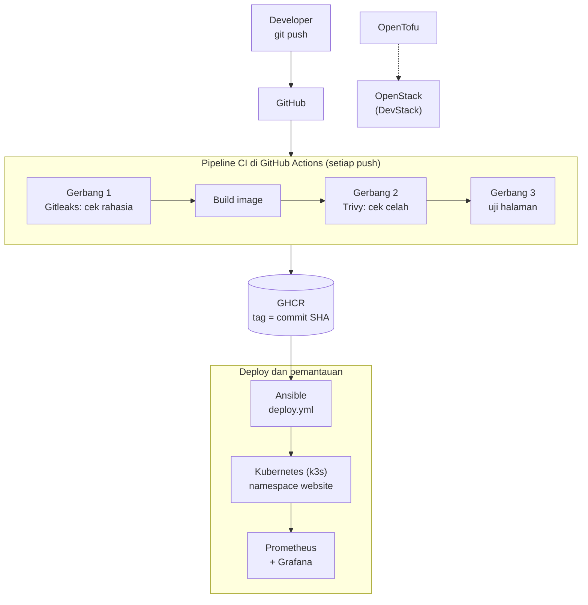
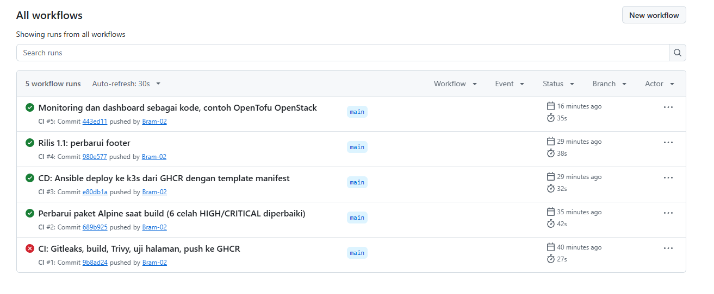
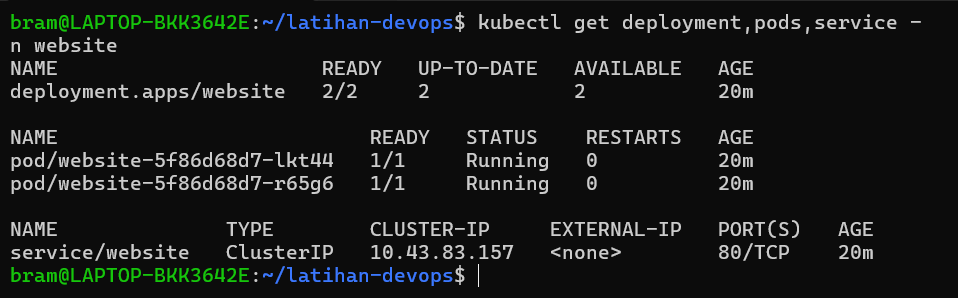
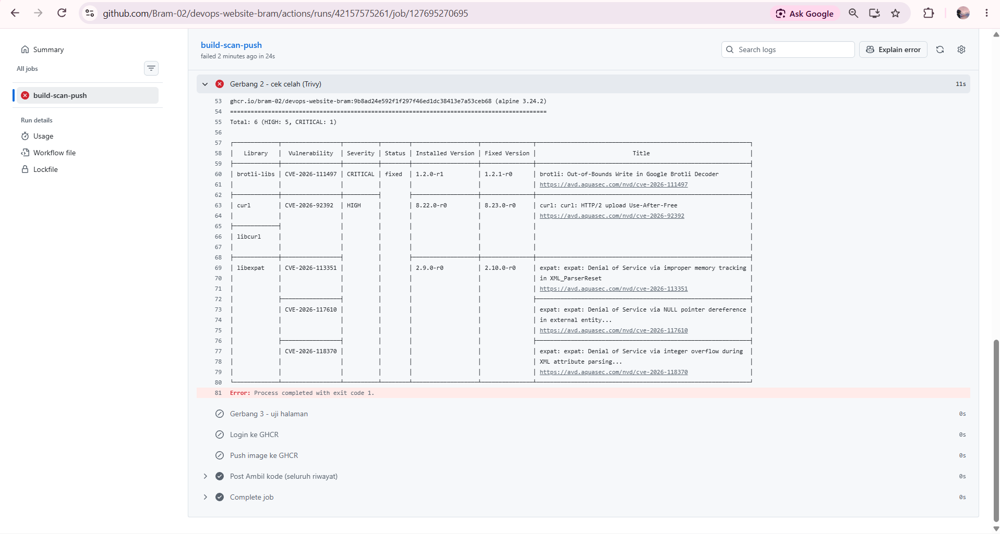
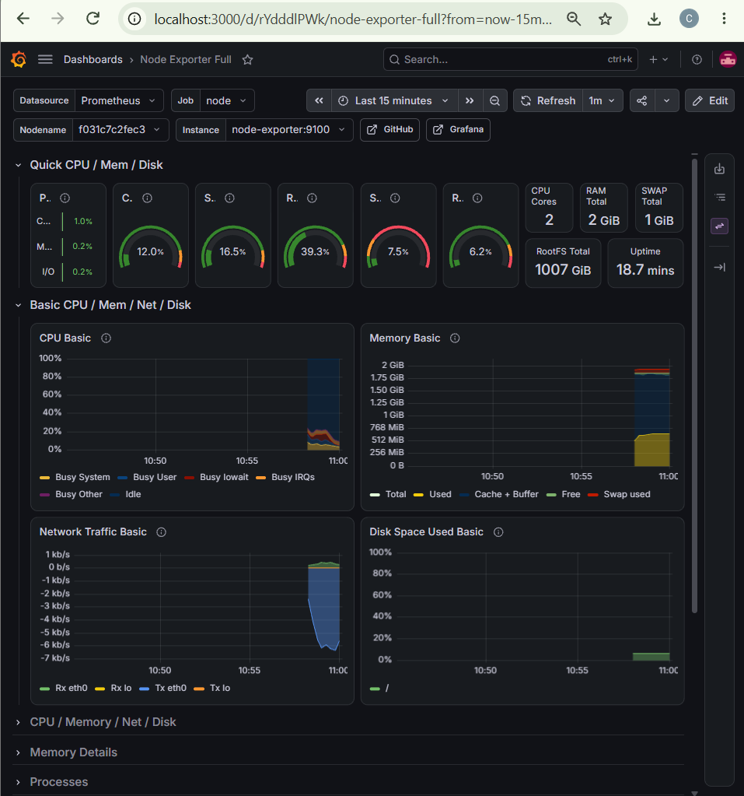

# DevOps Website Bram


Proyek DevOps end-to-end: sebuah website sederhana yang dibangun, diperiksa keamanannya, disimpan di registry, lalu di-deploy ke Kubernetes secara otomatis dan bisa di-rollback dengan satu perintah. Kondisi server dipantau dengan Prometheus dan Grafana, dan contoh infrastruktur private cloud ditulis dengan OpenTofu.

> **English summary:** End-to-end DevOps project. Every `git push` runs a GitHub Actions pipeline with three gates (Gitleaks secret scan, Trivy vulnerability scan, page test) before the image is pushed to GitHub Container Registry, tagged with the commit SHA. Ansible deploys a specific version to a hardened Kubernetes (k3s) deployment with rolling updates and one-command rollback. Monitoring (Prometheus, node-exporter, Grafana) and its dashboards are provisioned as code. An OpenTofu example provisions an instance on a private OpenStack (DevStack) cloud.

**Penyusun:** Bram Naibaho, D3 Teknologi Komputer, Institut Teknologi Del

---

## Arsitektur



| Tahap | Alat | Fungsi |
| --- | --- | --- |
| Kode | Git, GitHub | Semua kode, konfigurasi, dan dashboard disimpan di repository ini |
| CI | GitHub Actions | Build dan uji otomatis setiap `git push` |
| Keamanan | Gitleaks, Trivy | Pipeline gagal kalau ada rahasia bocor atau celah HIGH/CRITICAL yang bisa diperbaiki |
| Container | Docker, nginx-unprivileged | Website berjalan tanpa root, di port 8080, dengan HEALTHCHECK |
| Registry | GitHub Container Registry | Image disimpan dengan tag `latest` dan tag commit SHA |
| Deploy | Ansible, Kubernetes (k3s) | Deploy versi tertentu, rolling update, rollback satu perintah |
| Monitoring | Prometheus, node-exporter, Grafana | Data source dan dashboard dipasang otomatis dari file |
| Infrastruktur | OpenTofu, OpenStack | Contoh membuat instance di private cloud dari kode |

---

## Hasil keamanan

| Pemeriksaan | Sebelum | Sesudah | Cara |
| --- | --- | --- | --- |
| Rahasia di riwayat Git (Gitleaks) | - | 0 kebocoran | `.gitignore`, password di `.env` dan `clouds.yaml` di luar repository |
| Celah HIGH/CRITICAL image (Trivy) | 66 | 0 | Base image Debian diganti Alpine |
| Celah yang ditangkap gerbang CI | 6 (1 CRITICAL) | 0 | `apk upgrade` saat build |
| Temuan konfigurasi Dockerfile | 2 | 0 | `USER` non-root dan `HEALTHCHECK` |
| Temuan konfigurasi Kubernetes | 19 | 1 | securityContext, batas CPU/RAM, namespace sendiri |

Sisa satu temuan (KSV-0125, registry publik) diterima secara sadar untuk lingkungan lab. Di lingkungan perusahaan, image disimpan di registry privat yang diizinkan.

---

## Struktur repository

```
.
├── .github/workflows/ci.yml        # Pipeline CI: Gitleaks, build, Trivy, uji, push ke GHCR
├── app/
│   ├── Dockerfile                  # nginx tanpa root, port 8080, HEALTHCHECK
│   └── index.html
├── k8s/website.yaml.j2             # Manifest Kubernetes (template, versi image diisi Ansible)
├── ansible/
│   ├── inventory.ini
│   └── deploy.yml                  # Nyalakan k3s, isi template, apply, tunggu rollout
├── monitoring/
│   ├── compose.yaml                # node-exporter, Prometheus, Grafana
│   ├── prometheus.yml
│   └── grafana/                    # Data source dan dashboard sebagai kode
└── infra/opentofu-openstack/       # Contoh instance OpenStack dengan OpenTofu
```

---

## Cara menjalankan

### Prasyarat

- Linux (diuji di Ubuntu 24.04 di WSL2) dengan Docker, Ansible, dan k3s
- `kubectl` dapat mengakses cluster melalui `~/.kube/config`

### 1. Uji aplikasi secara lokal

```bash
docker build -t devops-website-bram:local ./app
docker run -d --name uji -p 8080:8080 devops-website-bram:local
curl -s http://localhost:8080 | grep "<title>"
docker rm -f uji
```

### 2. Deploy ke Kubernetes (versi tertentu)

Setiap image di GHCR diberi tag commit SHA. Deploy versi commit terakhir:

```bash
cd ansible
ansible-playbook -i inventory.ini deploy.yml -K -e image_tag=$(git rev-parse HEAD)
kubectl port-forward -n website svc/website 8085:80
```

Buka `http://localhost:8085`.

### 3. Rollback

Kembali ke versi sebelumnya cukup dengan mengganti tag:

```bash
ansible-playbook -i inventory.ini deploy.yml -K -e image_tag=$(git rev-parse HEAD~1)
```

Kubernetes mengganti pod secara bertahap (rolling update), jadi website tidak mati selama pergantian.

### 4. Monitoring

```bash
cd monitoring
read -s -p "Password admin Grafana: " PW; echo "GF_SECURITY_ADMIN_PASSWORD=$PW" > .env; unset PW
chmod 600 .env
docker compose up -d
```

- Grafana: `http://localhost:3000` (user `admin`), dashboard **Node Exporter Full** langsung tersedia
- Prometheus: `http://localhost:9090/targets`

### 5. Infrastruktur OpenStack (opsional)

Membutuhkan OpenStack (misalnya DevStack) dan kredensial di `~/.config/openstack/clouds.yaml`, yang tidak disimpan di repository.

```bash
cd infra/opentofu-openstack
tofu init
tofu plan
tofu apply
```

---

## Keputusan desain

- **Tag image = commit SHA, bukan `latest`.** Tag `latest` tidak memicu update di Kubernetes karena namanya tidak berubah, tidak bisa dilacak, dan tidak bisa di-rollback dengan pasti. Commit SHA unik untuk setiap versi.
- **Gerbang keamanan di CI.** Image yang membawa rahasia atau celah HIGH/CRITICAL yang sudah ada perbaikannya tidak pernah sampai ke registry. Opsi `--ignore-unfixed` dipakai agar rilis tidak terblokir oleh celah yang belum punya perbaikan.
- **Least privilege.** Container berjalan sebagai user biasa, sistem file hanya-baca, semua capability Linux dicabut, dan setiap pod dibatasi CPU dan RAM-nya.
- **Semua sebagai kode.** Manifest, playbook, konfigurasi monitoring, data source, dan dashboard Grafana disimpan di Git; rahasia tidak.

---

## Kendala yang dihadapi

| Kendala | Penyebab | Solusi |
| --- | --- | --- |
| Pipeline merah di run pertama | Trivy menemukan 6 celah di image dasar `nginx-unprivileged` (Alpine 3.24.2) | `apk upgrade --no-cache` saat build, diuji lokal dengan perintah yang sama sebelum push |
| Versi baru tidak ter-deploy | Manifest tetap memakai tag `latest`, sehingga `kubectl apply` menilai tidak ada perubahan | Deploy dengan tag commit SHA |
| Trivy timeout | Unduhan database pertama melebihi batas 5 menit | `--timeout 15m` dan cache di volume |
| Instance OpenStack tidak bisa menyala | Virtualisasi bersarang tidak tersedia setelah WSL2 aktif | Nova diubah ke mode QEMU dengan playbook Ansible; latihan memakai image CirrOS yang kecil |

---

## Tangkapan layar

| Pipeline CI | Pod di Kubernetes |
| --- | --- |
|  |  |

| Pemindaian Trivy | Dashboard Grafana |
| --- | --- |
|  |  |

---

## Kontak

- LinkedIn: [bram-modestus-naibaho](https://www.linkedin.com/in/bram-modestus-naibaho-95866b387/)
- Portofolio: [bram-modestus-naibaho.vercel.app](https://bram-modestus-naibaho.vercel.app)
